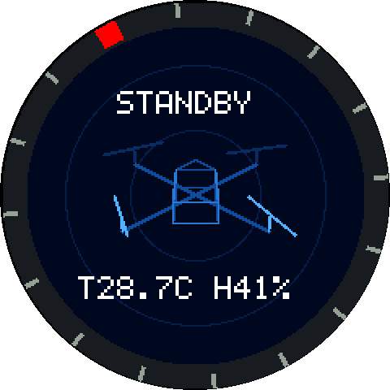
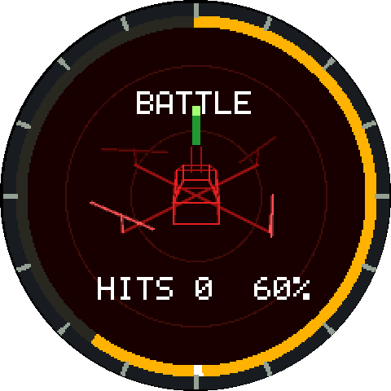
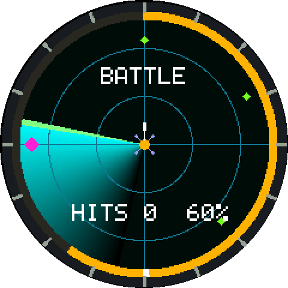

# FPGA 3D Wireframing: STM32 drone + FPGA Command Centre

A real-time embedded "attack drone" on an STM32 (Arm Cortex-M4), linked both ways to a Command Centre whose Lattice ECP5 FPGA draws a live radar, a 3D wireframe of the drone's attitude and a zombie game, with no frame buffer.

<p>



</p>

Built for EE2028 (Microcontroller Programming and Interfacing), National University of Singapore, Nov 2026.

## How it fits together

```
STM32 drone ──UART──▶ laptop (bridge.py) ──USB──▶ RP2350 (code.py) ──SPI──▶ ECP5 FPGA ──▶ round 240x240 display, LEDs, buzzer
            ◀── game events (K H M A B G) ◀──────────────────────── counters ◀──┘
```

| Folder | What | Language |
|---|---|---|
| [`stm32/`](stm32/Assignment2) | The drone: non-blocking state machine, 6-sensor telemetry, interrupt button, OLED driver, IR sensor, attitude filter, link protocol. Main code: `Core/Src/main.c` | C (STM32 HAL/BSP) |
| [`fpga/`](fpga) | The renderer: radar pipeline, 3D wireframe engine, zombie game, SPI link. Source in `fpga/src` | Verilog |
| [`greymecha/`](greymecha) | RP2350 side (`code.py`), FPGA loader (`ccfpga/`), laptop relay (`bridge.py`), built bitstreams | Python |

## Highlights

- **No frame buffer:** each pixel's colour is computed just before the display needs it, in a 6-stage pipeline at 75 MHz, ~40 fps.
- **3D in hardware:** once per frame, 32 vertices are rotated by roll, pitch and yaw and projected. Then, for every pixel, 32 line testers and 4 object testers run in parallel using incremental edge functions (adders only), with anti-aliasing.
- **No double buffering:** new line values load at display row 16, hidden behind the round bezel.
- **Timing closure:** 54 MHz → 80 MHz (77.5 MHz required) through pipelining, register insertion and removing inferred multipliers. About ⅔ of the ECP5-25K logic, 25 of 28 multipliers.
- **Non-blocking firmware:** no delays anywhere; every task runs off the 1 ms tick. Button by EXTI interrupt with a critical section; OLED sends at most one 128-byte page per loop pass.
- **Two-way link:** status 5×/s and attitude 40×/s from the drone; checksummed SPI packets to the FPGA; game events back to the drone.

## Run it

1. **STM32 (B-L4S5I-IOT01A):** import `stm32/Assignment2` into STM32CubeIDE (*File → Import → Existing Projects into Workspace*), build, run. Full steps: [`stm32/Assignment2/HOW_TO_RUN.md`](stm32/Assignment2/HOW_TO_RUN.md).
2. **GreyMecha:** copy `greymecha/code.py`, `greymecha/cc_radar.bit` and the `greymecha/ccfpga/` folder to the CIRCUITPY drive.
3. **Relay:** `pip install pyserial`, then `python greymecha/bridge.py <drone port> <greymecha port>`.

**Controls:** STM32 button (single = charge, double = mode / rescue) · FPGA centre button = radar / 3D · left / right = turn the aim · IR sensor spawns zombies.

## Rebuild the FPGA design

Open-source toolchain (`pip install yowasp-yosys yowasp-nextpnr-ecp5`); commands in [`fpga/README.md`](fpga/README.md). Testbenches for Icarus Verilog are in `fpga/sim`.

## Credits

- GC9A01 display driver (`fpga/src/oled_*.v`, `simple_spi_master.v`, `ecp5_oled_pll.v`): reused from the GreyMecha community repository.
- ECP5 JTAG loader (`greymecha/ccfpga/`): by EMARD, BSD licence, adapted from the GreyMecha factory files.
- `stm32/Assignment2/Drivers`: STMicroelectronics HAL, BSP and CMSIS, under their own licences.
